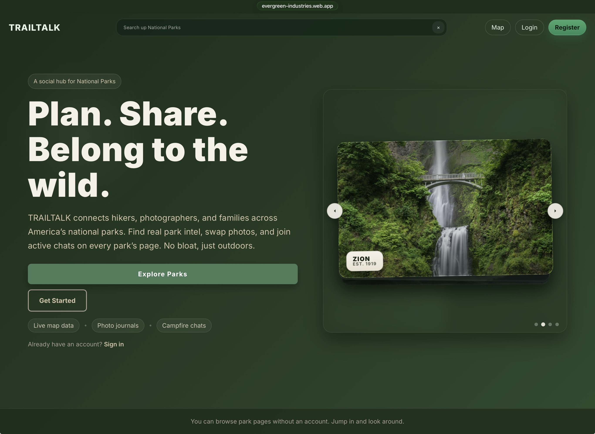
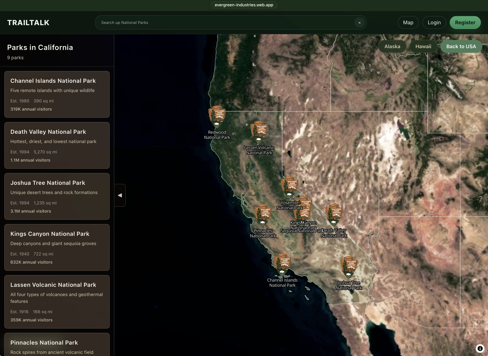
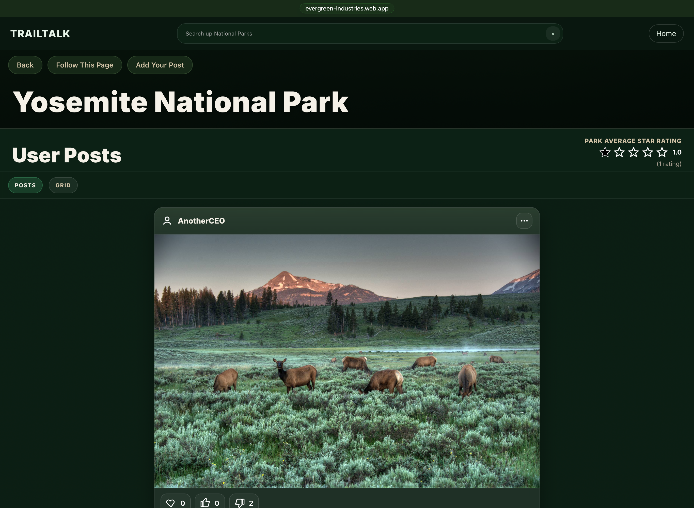
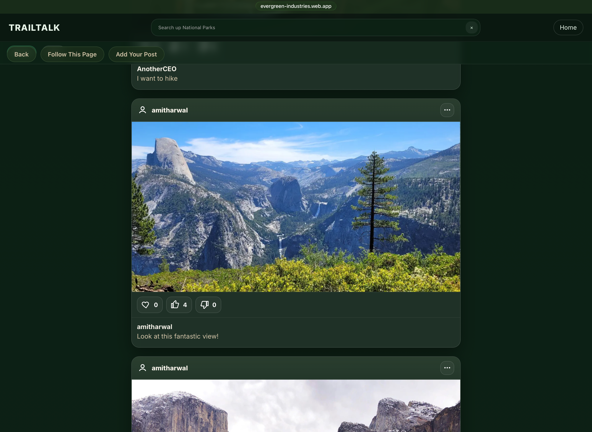

# TrailTalk

미국 국립공원 방문자들이 공원을 찾고, 사진과 후기를 공유하는 커뮤니티 웹앱입니다. 지도에서 공원을 선택하면 해당 공원의 포스트를 스크롤로 읽을 수 있습니다. 로그인한 사용자는 글과 이미지를 올리고, 추천 및 좋아요, 싫어요로 반응할 수 있습니다.

처음에는 5인 팀 프로젝트로 만들었고, 이 repository는 그 이후 개인적으로 이어서 개선한 버전입니다.

**Live:** https://evergreen-industries.web.app

## App flow

1. `/` 랜딩에서 **Map** 또는 헤더 검색으로 이동합니다. 로그인 전에는 Login / Register가 보이고, 로그인 후에는 프로필로 들어갈 수 있습니다.

2. `/map`에서 국립공원 지도를 탐색합니다. 헤더에서 공원 이름을 검색하거나 지도의 공원을 누르면 공원 페이지 `/parks/:slug`로 이동합니다.

3. 공원 페이지에서는 그 공원의 포스트가 위에서 아래로 나열됩니다. 각 글의 사진, 작성자, 본문을 스크롤로 읽고, 추천 및 좋아요와 싫어요로 반응할 수 있습니다.

4. **Register / Login** 후 **Add Your Post**에서 공원, 글, 이미지를 올려 피드를 추가합니다.
5. `/profile`에서 내 계정 정보와 내가 쓴 포스트를 확인합니다.

## Stack

| Tech | 역할 |
|------|------|
| **React + TypeScript** | UI, 라우팅, 상태·폼 로직 |
| **Vite** | 개발 서버·프로덕션 번들 |
| **React Router** | `/map`, `/parks/:slug`, `/login` 등 클라이언트 라우팅 |
| **MapLibre + MapTiler** | 국립공원 지도·타일 렌더링 |
| **Firebase Auth** | 이메일 회원가입·로그인 |
| **Firestore** | 포스트·유저 데이터 저장 |
| **Firebase Storage** | 포스트 이미지 업로드 |
| **Firebase Hosting** | `dist/` 정적 배포 |
| **Vitest + Testing Library** | Header / Login / Registration 등 컴포넌트 테스트 |
| **GitHub Actions** | 브랜치·PR CI, `main` push 시 Hosting 자동 배포 |

백엔드 서버 없이 Firebase BaaS로 Auth, DB, Storage, Hosting을 처리합니다.
